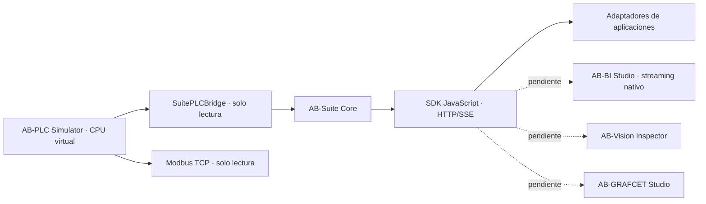

# AB-Suite Core

**MS ROBOTIKA · Plataforma de integración industrial virtual · v0.1.0**

[](https://github.com/msrobotika/AB-Suite-Core-arquitectura-de-integraci-n/actions/workflows/ci.yml)
[](LICENSE)

Bus de eventos y SDK propios para interconectar herramientas de MS ROBOTIKA **sin duplicar** los editores KOP, SCL, GRAFCET, el simulador PLC, la aplicación de visión o AB-BI Studio.

> **Alcance real:** bus local HTTP/SSE, contratos versionados, credenciales por aplicación, histórico limitado y adaptador read-only de telemetría PLC. Todavía no es una suite distribuida por red ni está conectada directamente a los proyectos Vision o GRAFCET.

## Arquitectura



El bus es **headless**: no incluye un editor ni necesita capturas decorativas. Su funcionamiento está respaldado por pruebas de red, contratos y eventos.

## Requisitos e instalación

Node.js **20 o superior**, Windows, Linux o macOS. No hay dependencias de terceros en tiempo de ejecución.

```bash
git clone https://github.com/msrobotika/AB-Suite-Core-arquitectura-de-integraci-n.git
cd AB-Suite-Core-arquitectura-de-integraci-n
npm test
npm start
```

El servidor standalone abre **127.0.0.1:4175**. En consola imprime un token efímero por aplicación y un token **monitor** de solo lectura; no se guardan en disco. Termina con Ctrl+C.

| API | Método | Uso |
| --- | --- | --- |
| `/v1/health` | GET | Estado no sensible del bus |
| `/v1/events` | POST | Publicar evento autenticado y validado |
| `/v1/events` | GET | Suscripción SSE con cursor `after` |
| `/v1/events/history` | GET | Recuperar eventos retenidos |

## Ejemplo de consumo

En Windows PowerShell, con el servidor funcionando, abre una segunda consola:

```powershell
$env:AB_SUITE_TOKEN = "<TOKEN_MONITOR>"
node examples/subscribe.mjs
```

Publicación de un resultado de **visión sintético**, sin cámara conectada:

```powershell
$env:AB_VISION_TOKEN = "<TOKEN_AB_VISION>"
node examples/vision-publish.mjs
```

El código de los ejemplos está incluido; **no son conectores nativos** de los editores correspondientes.

## Integración con AB-PLC Simulator y AB-BI

La primera integración efectiva mantiene una **única CPU virtual** que abastece a la HMI, Modbus y el bus. Mientras se migra a una dependencia publicada, la aplicación AB-PLC Simulator conserva temporalmente una copia compatible del paquete. El comando del simulador es:

```bash
npm run suite:core
```

El conector de AB-BI Studio, desarrollado por separado, transforma los eventos SSE en CSV importable. No añade streaming nativo al dashboard.

Consulta [arquitectura](docs/ARCHITECTURE.md), [matriz de integraciones](docs/INTEGRATIONS.md), [contratos](docs/PROTOCOL.md) y [límites de seguridad](SECURITY.md).

## Calidad y límites

Ejecuta `npm run check` para validación de sintaxis y batería de pruebas. GitHub Actions cubre Node 20/22 en varios sistemas. Los eventos tienen secuencia monótona y permiten replay dentro del histórico de **1.000 eventos en memoria**; ante pérdida irreversible del cursor se notifica con HTTP 409.

El bus no es un broker MQTT, ni Modbus TCP, ni servidor OPC UA, ni componente certificado IEC 61508/62443. No ofrece acceso a equipos físicos, no dispone de persistencia tras reinicio, ACK distribuido ni garantía de entrega exactamente una vez. Solo escucha en **127.0.0.1**.

**Licencia:** MIT · MS ROBOTIKA.
