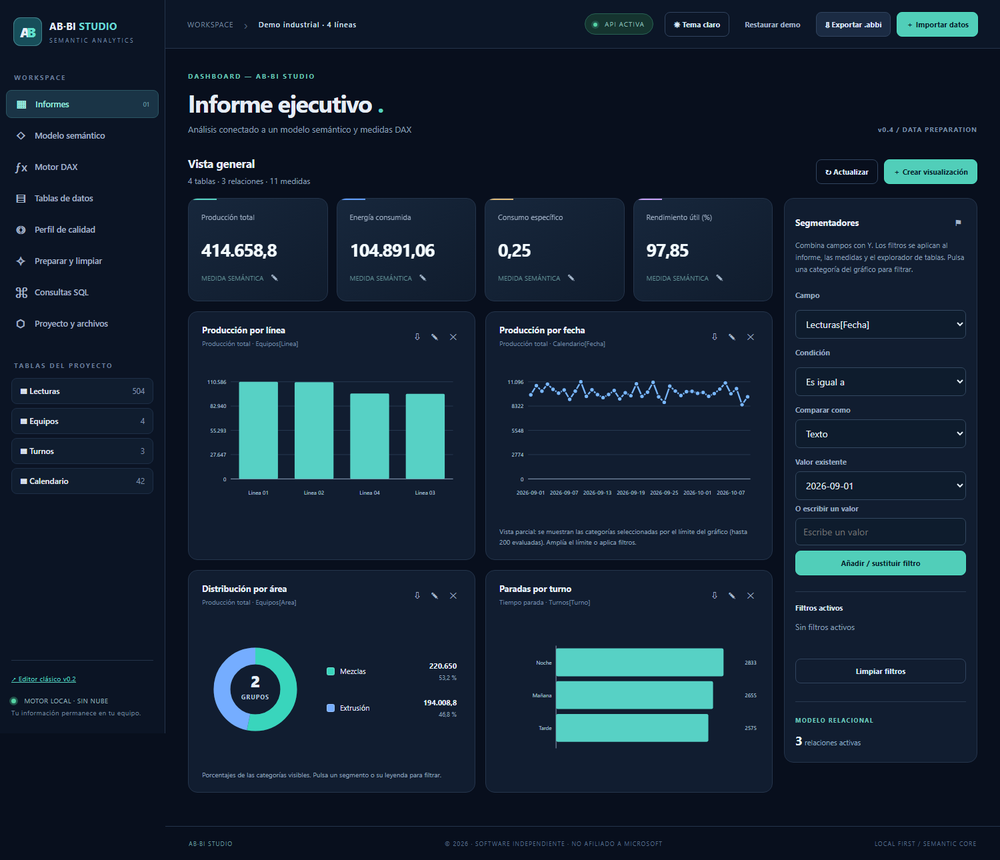
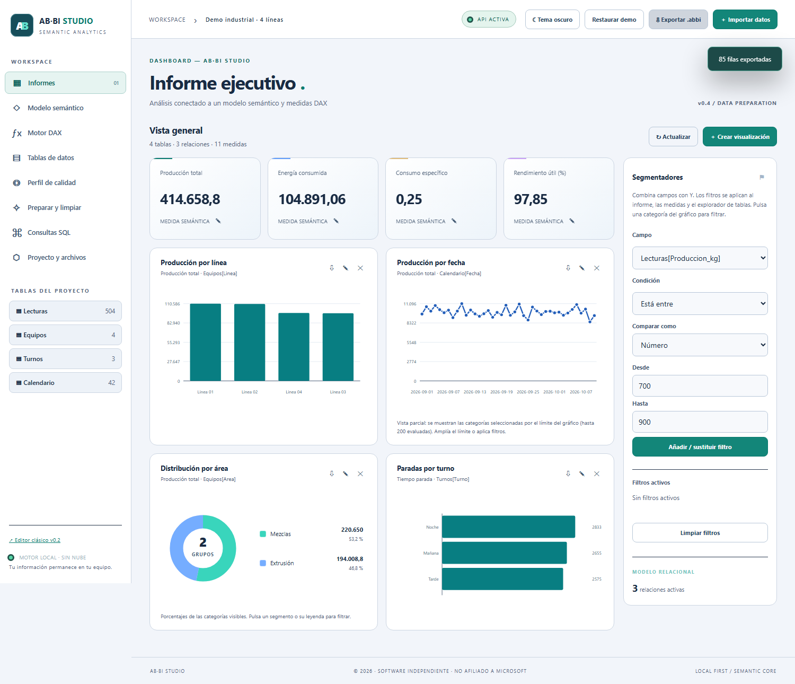
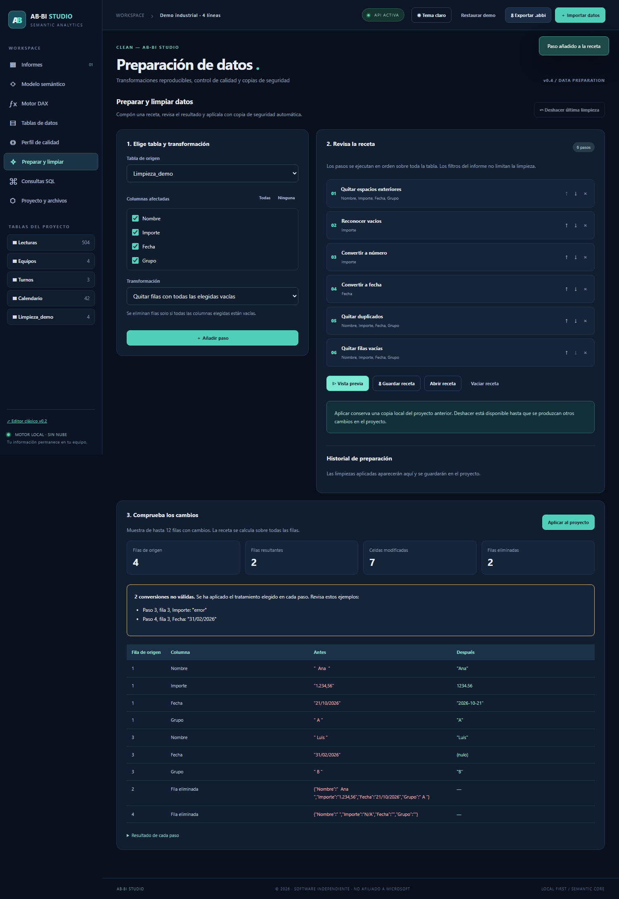
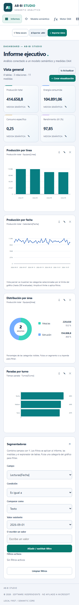
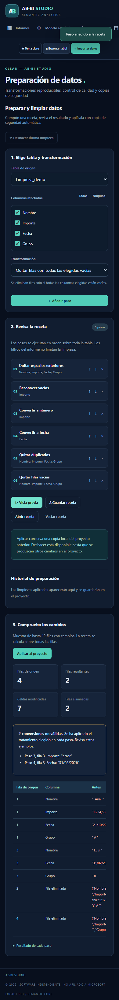

# Capturas de AB-BI Studio v0.4

Capturas reales generadas en Chromium por las pruebas de navegador, con datos de demostración ficticios. Las pantallas muestran la aplicación local; no contienen datos privados del usuario.

## Informe en modo oscuro

Donut con segmentos diferenciados, leyenda, valores y porcentajes.

## Informe en modo claro

## Preparación y vista previa

Receta de seis pasos, filas resultantes y comparación antes/después. Las dos conversiones inválidas del ejemplo se muestran de forma explícita.

## Adaptación móvil

[Informe móvil](ABBI_04_movil.png) · [Preparación móvil](ABBI_04_limpieza_movil.png)

## Regeneración

Las pruebas de `tests/test_browser.py` regeneran estas cinco imágenes. Usa datos temporales aislados y su propio servidor local. Las capturas `ABBI_03_*.png` se conservan solo como referencia histórica y no representan la interfaz actual.
