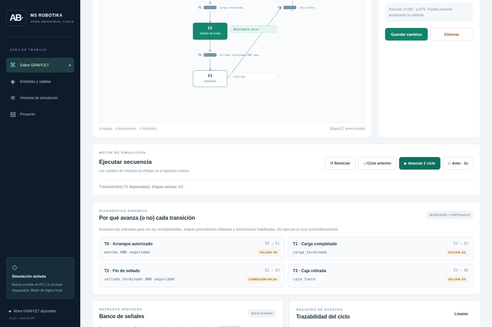
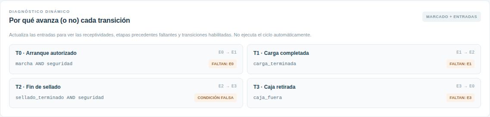
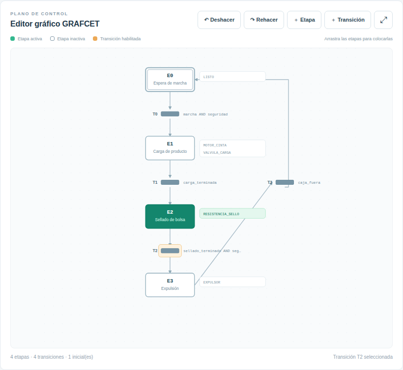
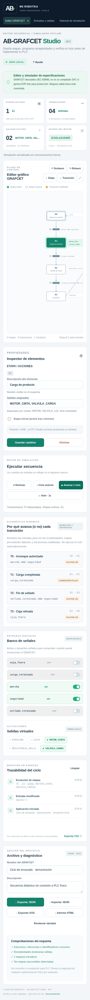

> Documento de la aplicación independiente de origen. La entrada, conexiones y capturas de la distribución integrada se describen en el [README de AB Suite](../../README.md). Las capturas históricas de este documento no representan el rediseño actual.

# AB-GRAFCET Studio 0.2 · MS ROBOTIKA

> **Ficha del proyecto · MS ROBOTIKA**  
> **Área:** Editor y simulador GRAFCET · **Estado:** v0.2 · simulador experimental (repositorio público)  
> **Evidencia:** [CI y pruebas](https://github.com/msrobotika/AB-GRAFCET-Studio-v0.1-c/actions) · [Capturas](docs/screenshots/) · [Estado técnico](docs/PROJECT_STATUS.md)  
> **Límite:** No existe exportación certificada KOP/SFC ni conexión física con PLC.

**Editor y simulador GRAFCET original · Código abierto MIT · En español · Windows/Linux/macOS · 100 % local**

Versión mejorada de nuestro editor didáctico de secuencias industriales, basado en conceptos de GRAFCET. Permite construir etapas, receptividades y acciones virtuales, comprender por qué una transición no avanza y comprobar ciclos sin accionar maquinaria.

**Repositorio independiente:** esta edición se publica en `msrobotika/AB-GRAFCET-Studio-v0.1-c` (el nombre exacto creado en GitHub). La versión 0.2 incorpora las mejoras y mantiene compatibilidad con proyectos de la versión 0.1.

## Abrir y descargar

[**Descargar HTML portátil (sin instalación)**](AB-GRAFCET-Studio-PORTABLE.html) · [**Descargar código completo en ZIP**](https://github.com/msrobotika/AB-GRAFCET-Studio-v0.1-c/archive/refs/heads/main.zip)

Guarda `AB-GRAFCET-Studio-PORTABLE.html` y ábrelo con Edge, Chrome o Firefox. Funciona sin Python, PLC, internet o CDNs. Para desarrollar, usa `index.html` junto a `src/` y abre el proyecto desde un servidor estático local.

### Uso inicial paso a paso

1. Se carga el proyecto de demostración **Ciclo de envasado**, con E0 como etapa inicial.
2. Activa la entrada `marcha` y deja `seguridad` en ON; pulsa **Avanzar 1 ciclo** para ir a E1.
3. Activa `carga_terminada` y pulsa **Avanzar** para ir a E2, con la salida virtual `RESISTENCIA_SELLO`.
4. Revisa **Diagnóstico dinámico**: verás las transiciones habilitadas, las etapas faltantes y las condiciones falsas.
5. Utiliza **Ciclo anterior** para retroceder un avance. **Deshacer/Rehacer** recupera cambios del esquema, no el estado de entradas.
6. Exporta tu proyecto como JSON, esquema SVG, registro CSV o **Informe HTML** imprimible.

## Capturas reales del programa

Las cinco imágenes proceden de **Chromium ejecutando esta aplicación real**, mediante [captura automatizada](tools/capture_screenshots.py) en [GitHub Actions](.github/workflows/grafcet-ci.yml). Se verifica el ciclo de E0 a E2 antes de guardar PNG. No se utilizan mockups ni pantallas dibujadas por separado.

### Escritorio y simulación



### Diagnóstico de receptividades y etapas faltantes (nuevo)



### Editor de etapas y transiciones



### Interfaz móvil



[Ver captura de toda la página](docs/screenshots/grafcet-proyecto-completo.png).

## Novedades de la versión 0.2

- **Diagnóstico dinámico**: para cada transición muestra etapas de origen/destino, condición, marcado faltante, receptividad falsa o habilitación.
- **Deshacer/Rehacer**: conserva los últimos 40 cambios del esquema en memoria. Los cambios estructurales reinician la simulación; las entradas pueden modificarse independientemente.
- **Ciclo anterior**: hasta 200 estados anteriores, con su fotografía de entradas.
- **Informe HTML imprimible**: etapas, acciones, transiciones, condiciones, E/S virtuales y advertencias estructurales; los datos del usuario se codifican como texto.
- **Motor determinista de escenarios**: `runScenario(model, steps, initialInputs)` comprueba evoluciones y expectativas sin modificar el proyecto.
- **Diagnósticos adicionales**: condiciones constantemente falsas, transiciones con etapas de origen compartidas y autorretornos; estas alertas no son una prueba formal.
- **Compatibilidad** con proyectos JSON `schema: 1` de la v0.1.

### Alcance técnico y límites de seguridad

Este es un **simulador parcial GRAFCET**: etapas con acciones booleanas continuas, receptividades `AND`, `OR`, `NOT`, `0`, `1`, `TRUE`, `FALSE`; disparo simultáneo independiente; conflictos al intentar consumir la misma etapa. Evalúa **un paso por iteración** y no simula la semántica de exploración de un PLC real.

No implementa aún temporizadores normalizados, flancos, acciones almacenadas, macroetapas, semántica IEC completa, prioridades verificadas, exportación automática de KOP/ST/SFC ni comunicación con PLC. **No es un sistema de seguridad, programa ejecutable de Omron ni herramienta certificada conforme a IEC 60848**. Las salidas virtuales no accionan dispositivos. El ejemplo de `seguridad` es una entrada simulada, no una parada de emergencia.

## Pruebas

Para desarrollo, Node.js 20+ y Python 3.11+ con Playwright/Chromium:

```bash
node --check src/engine.js
node --check src/app.js
node --test tests/*.test.js
python -m pip install "playwright>=1.55,<2"
python -m playwright install chromium
python -m unittest discover -s tests -p 'test_browser*.py' -v
python tools/capture_screenshots.py
```

Consulta [la CI](.github/workflows/grafcet-ci.yml) para ver las pruebas y las capturas reproducibles. La edición de ejecución no requiere dependencias externas.

## Estructura, derechos y próximos pasos

`src/engine.js` contiene parser, simulación, diagnóstico y escenarios; `src/app.js` el editor, exportaciones y UI; `src/style.css` el diseño adaptativo; `tests/` las pruebas; `docs/screenshots/` los PNG reales.

Copyright © 2026 **MS ROBOTIKA** · [MIT](LICENSE) · [Hoja de ruta](ROADMAP.md) · [Seguridad](SECURITY.md) · [Cambios](CHANGELOG.md). Desarrollo propio asistido por IA, sin copiar código de herramientas comerciales.

## Integración con AB-Suite Core

El adaptador Node tools/suite_bridge.mjs utiliza nuestro motor nativo para simular proyectos JSON exportados y publicar eventos grafcet.stage.changed autenticados. No duplica el editor, no actúa sobre PLC y no sincroniza automáticamente la pestaña abierta.

[Instrucciones y alcance](docs/SUITE_CORE.md). Tests de adaptador y transporte local en Linux, Windows y macOS.
