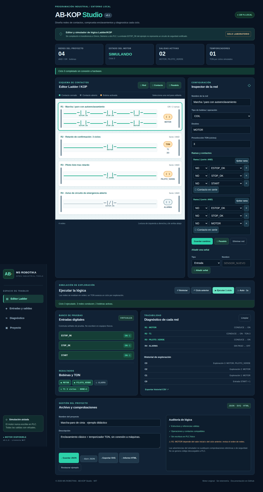
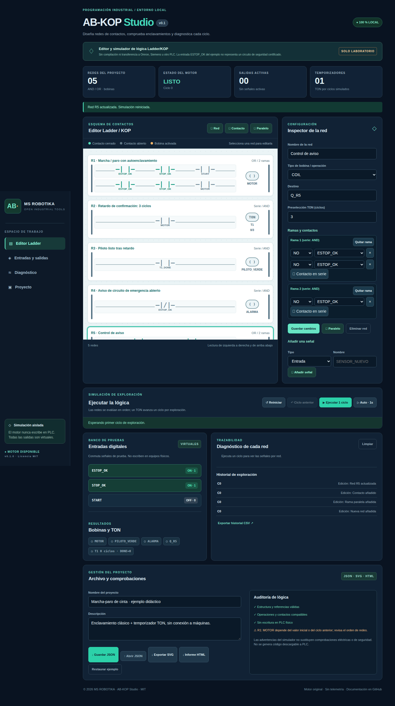
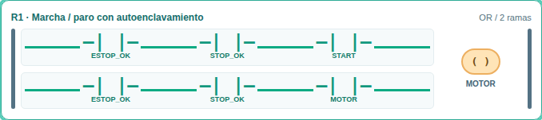
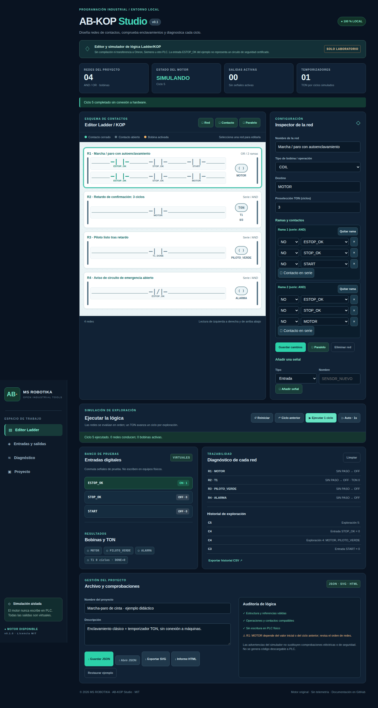
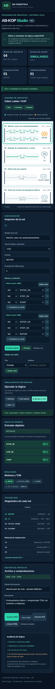

> Documento de la aplicación independiente de origen. La entrada, conexiones y capturas de la distribución integrada se describen en el [README de AB Suite](../../README.md). Las capturas históricas de este documento no representan el rediseño actual.

# AB-KOP Studio · MS ROBOTIKA

> **Ficha del proyecto · MS ROBOTIKA**  
> **Área:** Editor y simulador Ladder/KOP · **Estado:** v0.1 · simulación local  
> **Evidencia:** [CI y pruebas](https://github.com/msrobotika/AB-KOP-Studio-v0.1/actions) · [Capturas del programa](docs/screenshots/) · [Alcance y pendientes](docs/PROJECT_STATUS.md)  
> **Límite:** Sin comunicación física con PLC; temporizadores por ciclos virtuales.

**v0.1.0 · Ladder/KOP didáctico · Español · MIT · 100 % local**

AB-KOP Studio es un editor y simulador original de lógica de contactos: entradas digitales virtuales, contactos NO y NC, ramas en serie (AND) y paralelo (OR), bobinas COIL, SET, RESET y temporizadores TON por **ciclos simulados**. No conecta a PLC ni controla maquinaria.

**[Descargar el HTML portátil](AB-KOP-Studio-PORTABLE.html)** · **[Descargar el proyecto completo en ZIP](https://github.com/msrobotika/AB-KOP-Studio-v0.1/archive/refs/heads/main.zip)**

**Repositorio público independiente:** `msrobotika/AB-KOP-Studio-v0.1`.

## Capturas reales

Las imágenes se generan desde **la propia aplicación en Chromium**, con verificaciones sobre el motor y la interfaz; no son diseños simulados por una herramienta de imágenes.

### Enclavamiento y TON activos



### Editor de redes y ramas



### Circuito de marcha-paro



### Paro y desactivación del motor



### Interfaz móvil



## Comprobar la simulación en 6 pasos

1. Guarda y abre `AB-KOP-Studio-PORTABLE.html` desde tu navegador, sin instalar nada. Por defecto `ESTOP_OK=1`, `STOP_OK=1`, `START=0`.
2. Pulsa **START** y luego **Ejecutar 1 ciclo**: se activa `MOTOR`.
3. Suelta **START** y ejecuta otro ciclo: el contacto `MOTOR` mantiene la bobina enclavada.
4. Al tercer ciclo consecutivo se activa `T1_DONE`, que alimenta `PILOTO_VERDE`.
5. Desactiva **STOP_OK** y ejecuta otro ciclo: `MOTOR` y `PILOTO_VERDE` pasan a OFF; `T1` se reinicia.
6. Usa **Ciclo anterior** para revisar el estado y las entradas de la exploración precedente. Las redes se procesan de arriba abajo.

**Importante:** `ESTOP_OK` es un bit de laboratorio; **no simula ni reemplaza** una cadena de parada de emergencia real.

## Funciones implementadas

- Redes de contactos NO/NC; hasta 40 redes, 8 ramas/red y 12 contactos/rama.
- Bobinas normales, retenciones SET/RESET y temporizador TON de 1 a 3600 exploraciones.
- Entradas/salidas simuladas, diagnóstico por red, registro y hasta 200 ciclos de retroceso.
- Edición de redes, ramas, contactos, destinos y señales con validación.
- Importación/exportación JSON; plano SVG; historial CSV e informe HTML seguro.
- Ejecución sin bibliotecas JS externas, sin nube, sin telemetría.

## Pruebas y código fuente

```bash
node --check src/engine.js
node --check src/app.js
node --test tests/engine.test.js
python -m pip install 'playwright>=1.55,<2'
python -m playwright install chromium
python -m unittest discover -s tests -p 'test_browser.py' -v
```

La primera verificación local pasó **21 pruebas del motor y 10 de Chromium**. [GitHub Actions](.github/workflows/ci.yml) ejecuta las pruebas de la rama y vuelve a generar las imágenes de manera verificable.

## Limitaciones

Esto **no** es un compilador KOP para Omron CX-One, Siemens TIA Portal ni otra plataforma. La semántica IEC 61131-3 completa, direcciones físicas, precisión temporal de PLC, seguridad funcional y bloques especializados están fuera de alcance. No utilices esta aplicación para construir o validar funciones de seguridad.

**MS ROBOTIKA © 2026 · MIT** · [Licencia](LICENSE) · [Seguridad](SECURITY.md) · [Hoja de ruta](ROADMAP.md) · [Cambios](CHANGELOG.md). Código original desarrollado con asistencia de IA.
