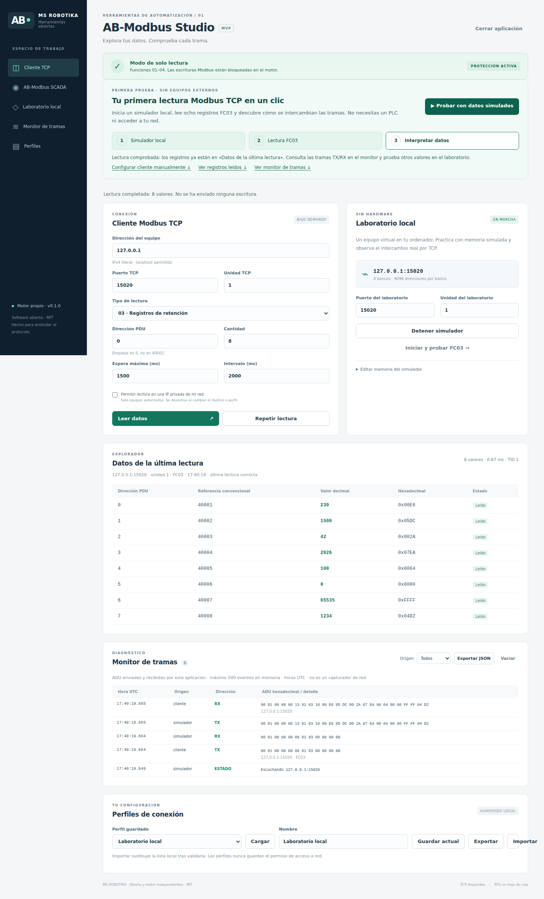
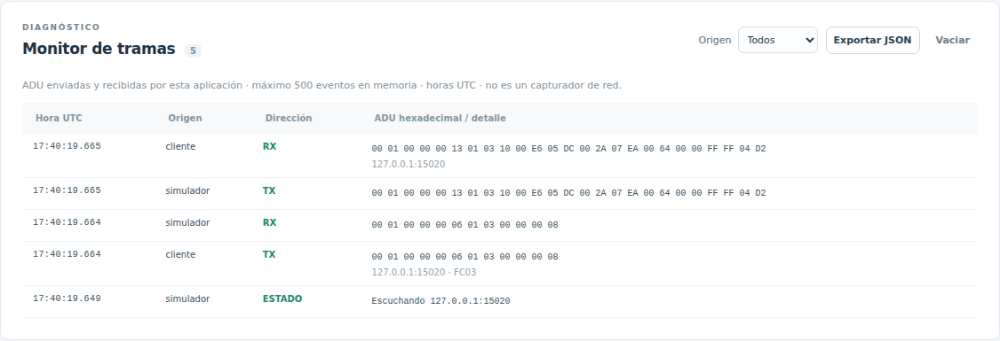
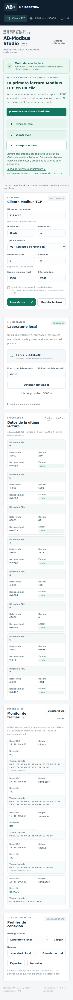

> Documento de la aplicación independiente de origen. La entrada, conexiones y capturas de la distribución integrada se describen en el [README de AB Suite](../../README.md). Las capturas históricas de este documento no representan el rediseño actual.

# AB-Modbus Studio

> **Ficha del proyecto · MS ROBOTIKA**  
> **Estado:** v0.1 · cliente Modbus TCP de solo lectura y laboratorio · **Licencia:** MIT (archivo LICENSE)  
> [**Capturas verificables**](docs/screenshots/) · [Pruebas/CI](https://github.com/msrobotika/AB-Modbus-Studio/actions) · [Estado técnico](docs/PROJECT_STATUS.md)  
> **Límite:** Sin escrituras a equipos industriales; pruebas con simulador local, no certificado.

**MS ROBOTIKA · 0.1.0 · MIT · Windows / Linux · interfaz en español**

Cliente Modbus TCP de solo lectura, simulador local y monitor de tramas.
Motor e interfaz escritos para este proyecto desde las especificaciones públicas,
sin incorporar bibliotecas Modbus ni código de otras aplicaciones.

## Capturas reales de la aplicación

Las tres imágenes de esta sección **se generan en GitHub Actions**. Si aún no
aparecen, la generación no se ha completado: entra en
[Acciones → Capturas reales de AB-Modbus Studio](https://github.com/msrobotika/AB-Modbus-Studio/actions/workflows/screenshots.yml),
elige **Run workflow**, rama **main**, y revisa que la ejecución termine correctamente.
El workflow guarda los PNG en \`docs/screenshots/\` y también como artefacto.

Estas imágenes se generan ejecutando el
programa y su simulador Modbus TCP en Chromium. No son renders conceptuales:
la captura de escritorio verifica una lectura FC03 de ocho registros y el
monitor de tramas muestra los intercambios TX/RX reales del laboratorio local.

**Escritorio · Cliente TCP y lecturas del simulador**



**Monitor de tramas Modbus TCP**



**Vista móvil · Diseño adaptable**



La vista móvil se captura en Chromium con un viewport de 390 × 844; no es una
aplicación nativa Android. Puedes reproducir la evidencia con
`python tools/capture_screenshots.py` después de instalar Playwright y su
Chromium de pruebas. Revisa
[el workflow de capturas](.github/workflows/screenshots.yml).
Estas capturas ilustran la versión 0.1.0 y no acreditan compatibilidad con
PLC físicos ni funcionalidad RTU.

## AB-Modbus SCADA · supervisión industrial (alfa)

**Nuevo módulo integrado:** abre AB-Modbus Studio y pulsa **AB-Modbus SCADA**
en el menú izquierdo. Conserva el motor original FC01–04 de solo lectura.
Incluye puntos en tiempo real, tendencia SVG, alarmas informativas por umbral,
histórico de 1000 muestras y exportación CSV, sin bibliotecas gráficas externas.
Una alarma no puede sustituir la protección o la parada de emergencia de una máquina.

Para verlo funcionando sin PLC, pulsa **Laboratorio local** y el simulador
devolverá los registros de prueba por TCP. No hay conexión automática a PLC
reales ni autorización de LAN persistente.

- [Instrucciones, alcances y seguridad del SCADA](docs/SCADA.md).
- [Capturas automáticas de SCADA desde Chromium y simulador TCP](https://github.com/msrobotika/AB-Modbus-Studio/actions/workflows/screenshots.yml).
- Los PNG se consultan en `docs/screenshots/` **solo después** de que la ejecución de GitHub Actions los genere correctamente. No se presentan mockups como capturas.

## Descargar y ejecutar

El código está en este repositorio. En GitHub, **Code → Download ZIP** descarga
el código de la rama seleccionada; **Releases** contiene los portables cuando
se ha publicado una versión. Un ZIP de código requiere Python; no es un instalador.
Comprueba los archivos concretos de cada Release y su SHA-256 antes de usarlos.
No hay actualizaciones ni descargas ocultas dentro de la aplicación.

### Windows portable

Extrae el ZIP portable completo en una carpeta y abre `AB-Modbus-Studio.exe`.
No necesita Python instalado ni permisos de administrador. Se abre el navegador
predeterminado y una consola de proceso. Pulsa **Cerrar aplicación** o Ctrl+C para
detenerla. El ejecutable no está firmado; no se ofrece certificado de firma.

### Linux portable

Extrae el ZIP portable de Linux, ejecuta `chmod +x AB-Modbus-Studio` y abre
`./AB-Modbus-Studio`. Se construye para Linux x86_64 en el runner Ubuntu de CI;
no se garantiza compatibilidad con distribuciones de glibc más antigua. Para
otras arquitecturas o distribuciones, usa el código fuente.

### Código fuente (Windows y Linux)

Requiere Python 3.11 o posterior y un navegador moderno. No necesita instalar
dependencias para ejecutar ni probar el código:

```sh
python -m ab_modbus
# En Linux, si el comando es python3:
python3 -m ab_modbus
```

En Windows también puedes abrir `AB-Modbus-Studio.bat`. En Linux:
`sh AB-Modbus-Studio.sh`. En un equipo sin apertura automática de navegador,
ejecuta con `--no-browser` y copia la URL completa que aparece en consola,
incluido el fragmento de sesión. La web solo escucha en `127.0.0.1`.

## Primera prueba en menos de un minuto

1. Abre la aplicación y pulsa **Iniciar y probar FC03 →**.
2. Verás ocho valores: `230, 1500, 42, 2026, 100, 0, 65535, 1234`.
3. Cambia el tipo a **01 · Coils** y pulsa **Leer datos**.
4. El monitor mostrará las ADU completas en hexadecimal, TX y RX de ambos extremos.
5. En **Editar memoria del simulador**, cambia un valor y vuelve a leer.
   La edición modifica memoria interna; no envía una función Modbus de escritura.

El laboratorio usa el puerto TCP 15020 y unidad 1 por defecto. Si el puerto está
ocupado, elige otro (1024–65535). Cada banco tiene 4096 direcciones, 0–4095.
Las referencias 00001/10001/30001/40001 son etiquetas convencionales; el campo
que se transmite es **Dirección PDU, base cero**. Para PDU mayores de 9998 la
columna de referencia muestra «—» para evitar etiquetas ambiguas.

## Qué incluye

- FC01 coils y FC02 entradas discretas (1–2000 bits por solicitud).
- FC03 retención y FC04 entrada (1–125 registros uint16 por solicitud).
- Lectura bajo demanda y repetición ≥1000 ms, sin solapamientos ni reintentos.
  Se detiene al fallar, editar parámetros o dejar la pestaña en segundo plano.
- Validación de MBAP, TID, Unit ID, función, longitudes y relleno de bits.
- Simulador exclusivamente local que rechaza funciones de escritura.
- Monitor propio de ADU con hasta 500 eventos en memoria y exportación JSON.
- Hasta 50 perfiles locales, importación/exportación JSON y persistencia atómica.
- API local autenticada por secreto aleatorio por ejecución, bloqueo de Host y
  Origin ajenos, sin CORS, recursos sin CDN ni telemetría.
- Pruebas de protocolo, TCP fragmentado/concatenado, errores y políticas de red.

## Conectar con AB-PLC Simulator (Suite MS ROBOTIKA)

Nuestro **AB-PLC Simulator** publica opcionalmente un PLC virtual por Modbus TCP en el mismo ordenador, únicamente para lectura. En el proyecto del simulador ejecuta **npm run suite:live**, abre la URL privada de la HMI y desde AB-Modbus Studio configura **127.0.0.1:1502, Unit ID 1, FC03, dirección 0, cantidad 5**, dejando desmarcada la autorización LAN. Puedes supervisar su CPU simulada sin conectarte a equipos industriales reales.

Consulta el [procedimiento de integración, mapa de registros y limitaciones](docs/AB_PLC_SIMULATOR.md). En Suite Live, el navegador y Modbus TCP consultan la misma CPU virtual del proceso Node; la alternativa npm run sim:modbus mantiene una instancia independiente.

## Conectar a un equipo autorizado

Introduce su IPv4 privada, puerto y unidad; marca **Permitir lectura en una IP
privada de mi red**. Solo se aceptan redes RFC1918 (10/8, 172.16/12, 192.168/16).
La autorización se reinicia al cambiar destino, cargar perfil o reiniciar sesión.
No se guardan permisos de red en perfiles. DNS, IP públicas, IPv6 y broadcast
no forman parte del MVP. No hay exploración ni descubrimiento de equipos.

Modbus TCP tradicional no aporta autenticación ni cifrado. Trabaja en una red de
laboratorio aislada y con autorización; incluso las lecturas generan carga.
No uses esta versión para funciones de seguridad ni control de producción.
Ver [SECURITY.md](SECURITY.md) para límites concretos.

## Perfiles y datos

Windows: `%LOCALAPPDATA%/MSRobotika/ABModbusStudio/profiles.json`.
Linux: `$XDG_CONFIG_HOME/ab-modbus-studio/profiles.json`, o
`~/.config/ab-modbus-studio/profiles.json` si no existe esa variable.
También se admite `--data-dir RUTA`. Un archivo incompatible se rechaza al
iniciar sin sobrescribirlo: consérvalo y usa otra carpeta para recuperar acceso.
Las tramas solo se guardan en disco si las exportas desde la interfaz.

## Probar y construir

```sh
python -m unittest discover -v
python -m ab_modbus --self-test
python -m venv .venv
# Activa el entorno de tu sistema antes de los siguientes pasos:
python -m pip install -r requirements-build.txt
python tools/build.py
```

`tools/build.py` ejecuta las pruebas, crea un portable para el sistema actual,
ejecuta la autoprueba del binario y reúne las licencias en `dist/`.
No compila Windows desde Linux ni Linux desde Windows. La configuración de CI
ejecuta pruebas en Windows/Linux y Python 3.11/3.13; un tag `v*` construye
portables y un borrador de Release para revisión.

## Arquitectura y estado

`protocol.py` es puro; `transport.py` limita lectura y destinos; `client.py`
expone solo lecturas; `server.py` aloja el laboratorio; `application.py` sirve la
API; `profiles.py` valida persistencia; `web/` contiene la interfaz propia sin
frameworks. Documentación: [arquitectura](docs/ARCHITECTURE.md),
[protocolo y procedencia](docs/PROTOCOL.md), [ROADMAP](ROADMAP.md),
[dependencias](DEPENDENCIES.md), [revisión legal preliminar](docs/LEGAL_REVIEW.md).

**RTU todavía no está implementado.** No hay puerto serie, CRC RTU, float32,
escrituras, TLS Modbus Security, certificación oficial ni pruebas sobre PLC físico.
El alcance de verificación de cada entrega se recoge en `docs/VERIFICATION.md`.

Copyright © 2026 MS ROBOTIKA. Licencia [MIT](LICENSE). Creado con asistencia de IA;
la originalidad de esta implementación no garantiza inmunidad jurídica ni sustituye
una revisión profesional de marcas, patentes, licencias y titularidad.
