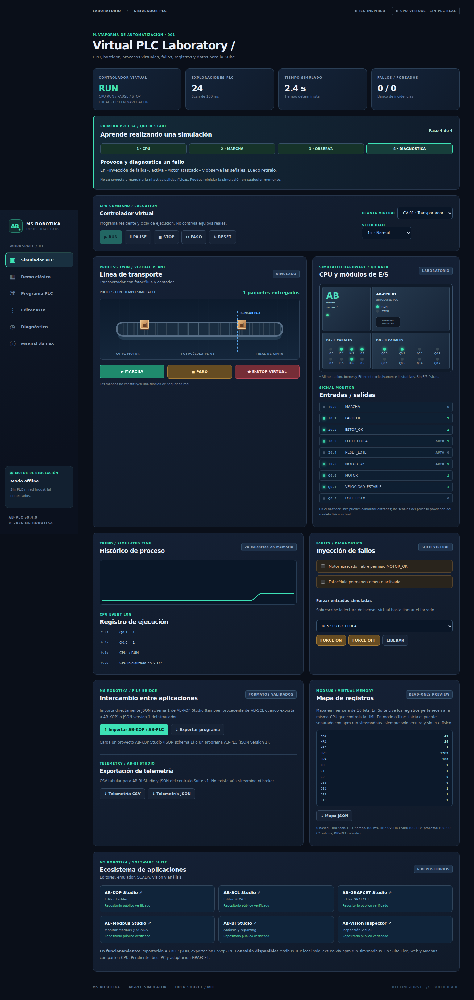
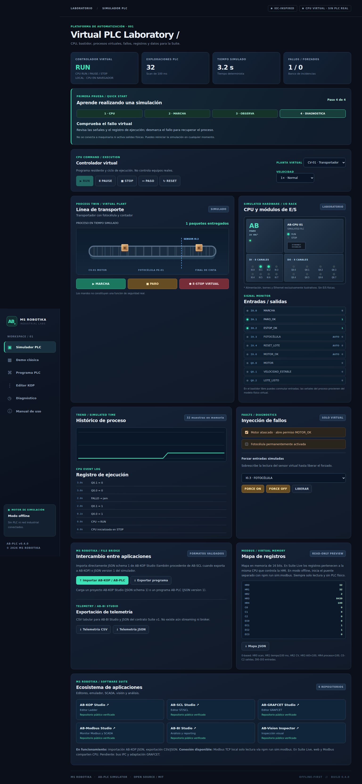
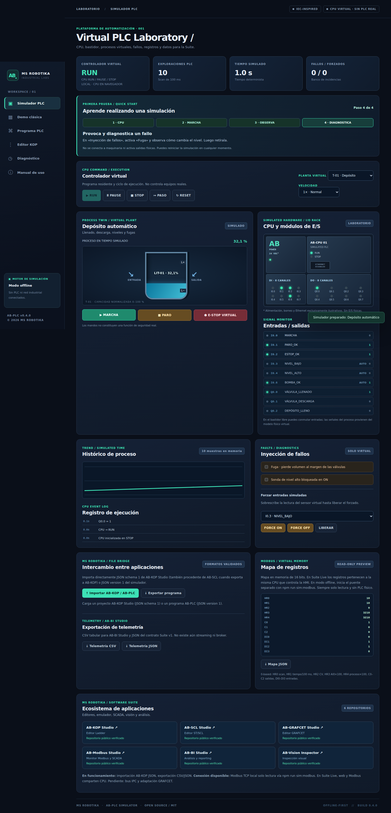
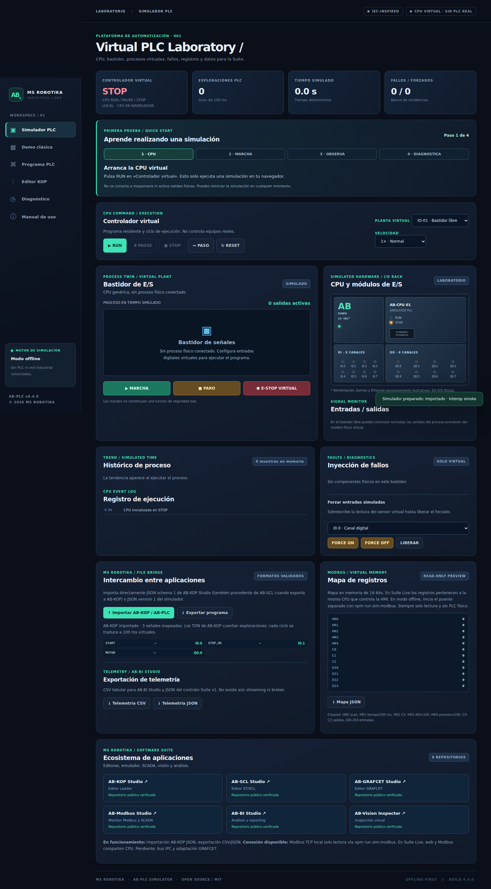
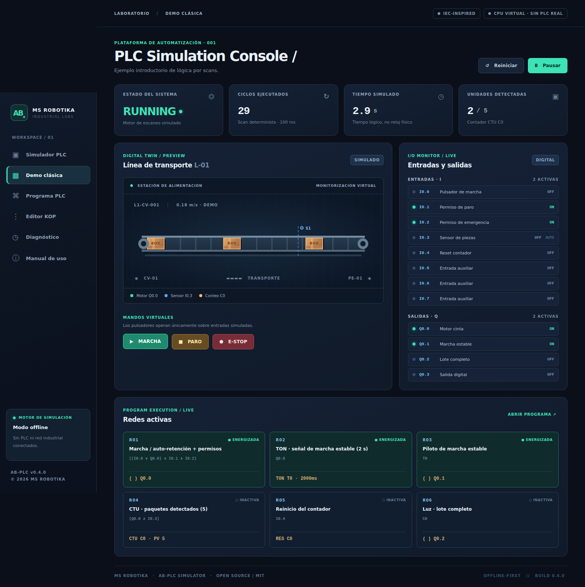
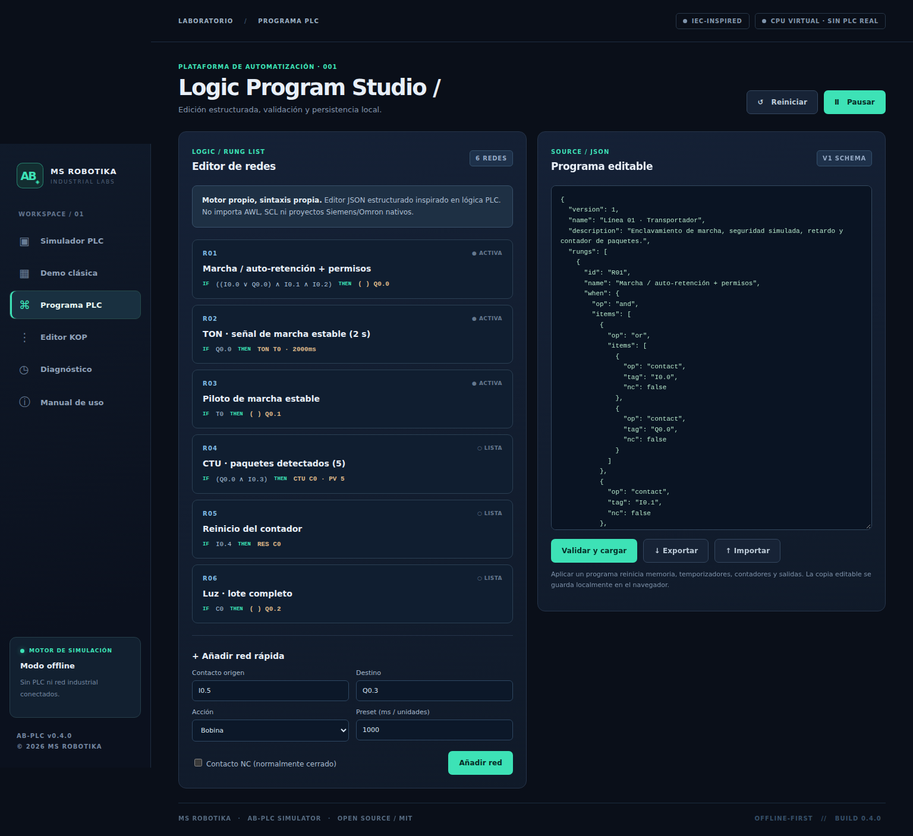
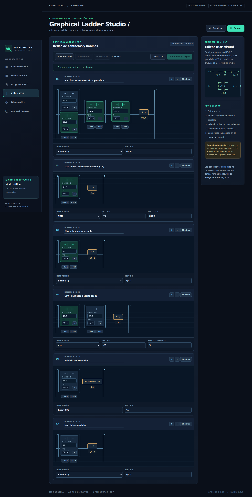

> Documento de la aplicación independiente de origen. La entrada, conexiones y capturas de la distribución integrada se describen en el [README de AB Suite](../../README.md). Las capturas históricas de este documento no representan el rediseño actual.

# AB-PLC Simulator

**MS ROBOTIKA · Industrial Labs · v0.4.0**

**Laboratorio de PLC virtual** con CPU RUN/PAUSE/STOP, exploración determinista, bastidor E/S, dos plantas virtuales (transportador y depósito), simulación de averías, forzado de sensores, pruebas y telemetría. El antiguo editor KOP permanece como módulo auxiliar; **el producto principal es el simulador de PLC**.

[Demo web (cuando GitHub Pages esté habilitado)](https://msrobotika.github.io/AB-PLC-Simulator/)

## Capturas de la aplicación real

### Consola del simulador de PLC

### Fallo mecánico e interbloqueo virtual

### Depósito: llenado y descarga

### Importación de programa AB-KOP al PLC

### Herramientas complementarias

La acción [Capture screenshots](.github/workflows/screenshots.yml) genera capturas auténticas del navegador y las versiona en docs/screenshots. Si la primera acción todavía no ha terminado, las imágenes aún no estarán disponibles.

## Funciones implementadas

| Función | Estado |
|---|---|
| CPU virtual RUN, PAUSE, STOP y STEP · scan determinista | ✅ |
| Bastidor digital de 8 DI/8 DO con representación de LED | ✅ |
| Escenarios transportador, depósito y bastidor libre | ✅ |
| Inyección de fallos, forzado virtual de entradas y eventos | ✅ |
| Historial de proceso, tendencias y exportación de telemetría | ✅ |
| Importación AB-KOP schema 1 / AB-SCL cuando exporta AB-KOP | ✅ |
| Contrato de intercambio Suite JSON y CSV para AB-BI | ✅ |
| Mapa Modbus in-memory en navegador; puente TCP local FC01–04 mediante Node | ✅ |
| Escaneo determinista, entradas/salidas y marcas | ✅ |
| Contactos NO/NC, AND/OR/NOT | ✅ |
| Coil, SET, RESET, TON, TOF, CTU | ✅ |
| Comparador de entrada analógica | ✅ |
| Consola responsive, cinta y sensores virtuales | ✅ |
| Editor KOP visual: NO/NC, serie/paralelo, bobinas, TON/TOF/CTU, undo/redo | ✅ |
| Inspector, registros de eventos, importación/exportación JSON | ✅ |
| Pruebas automáticas / GitHub Actions | ✅ |
| Importación nativa AWL/SCL/GRAFCET/formatos de fabricantes | **Pendiente** |
| Modbus TCP, OPC UA, conexión con PLC real | **Pendiente** |

No se afirma compatibilidad con formatos Siemens/Omron, ni conformidad IEC 61131-3.

## Ejecutar en Windows, Linux o macOS

Requiere **Node.js >= 20**. No necesitas instalar dependencias:

~~~bash
git clone https://github.com/msrobotika/AB-PLC-Simulator.git
cd AB-PLC-Simulator
npm run dev
~~~

Abre **http://127.0.0.1:4173**. Funciona sin conexión a Internet tras descargarlo.

Para ejecutar las pruebas:

~~~bash
npm test
npm run check
~~~

## Ejemplo de funcionamiento · Línea L-01

- Marcha I0.0 con autoenclavamiento de Q0.0.
- Paro I0.1 y permiso de emergencia I0.2: **simulados, no son seguridad real**.
- Temporizador TON T0 (2000 ms) que activa Q0.1.
- Sensor virtual de paquetes I0.3, contador CTU C0 (5 unidades) y piloto Q0.2.
- Reset de contador I0.4.

Las redes se definen en JSON con una condición y una acción:

~~~json
{
  "version": 1,
  "name": "Ejemplo",
  "rungs": [{
    "id": "R01",
    "name": "Marcha",
    "when": {"op":"contact","tag":"I0.0"},
    "action": {"type":"coil","target":"Q0.0"}
  }]
}
~~~

## Diseño técnico

~~~text
index.html                Interfaz
src/
  app.js                  UI, interacción y cinta virtual
  styles.css              Diseño responsive
  plant-runtime.js        CPU virtual y modelos deterministas de proceso
  lab-ui.js/lab-markup.js Consola de simulación PLC
  suite-contract.js       Contrato de intercambio y CSV
  kop-import.js           Adaptador real desde AB-KOP Studio
  kop-model.js            Conversión AST ↔ redes KOP visuales
  kop-ui.js               Edición de redes, historial, renderizado
  kop.css                 Estilos para diagramas KOP
  plc-engine.js           Motor determinista aislado de la UI
  demo-program.js         Ejemplo de seis redes
scripts/                  Servidor estático y capturas automatizadas
tests/                    Pruebas de lógica
docs/                     Arquitectura, seguridad, hoja de ruta, capturas
.github/workflows/        Verificación, capturas y Pages
~~~

Más detalles en [Laboratorio PLC](docs/PLC_LAB.md), [Interoperabilidad Suite](docs/SUITE_PROTOCOL.md), [Editor KOP](docs/KOP_EDITOR.md), [Arquitectura](docs/ARCHITECTURE.md), [Hoja de ruta](docs/ROADMAP.md) y [Seguridad](docs/SAFETY.md).

**Aviso:** uso educativo y de simulación. No controla máquinas, no implementa parada de emergencia física ni certifica seguridad funcional.

**Licencia:** [MIT](LICENSE). © 2026 MS ROBOTIKA.

## Escenarios ejecutables sin navegador

Reproducibles desde Node.js:

    npm run sim:demo
    npm run sim:tank
    node scripts/run-scenario.mjs --scenario examples/conveyor-with-fault.json --csv trace.csv

El simulador no necesita ejecutar editores para procesar scans. Lee [el laboratorio](docs/PLC_LAB.md) y [el contrato Suite](docs/SUITE_PROTOCOL.md).

## Conexión en vivo: AB-PLC Simulator → AB-Modbus Studio

Para disponer de un PLC simulado accesible mediante Modbus TCP desde **AB-Modbus Studio**, abre una consola en la carpeta del proyecto (Node.js 20+) y ejecuta:

    npm run sim:modbus

En AB-Modbus Studio configura **Host 127.0.0.1, puerto 1502, Unit ID 1**. Las funciones compatibles son:
- **FC01** · coils 0–2: Q0.0, Q0.1, Q0.2.
- **FC02** · entradas digitales 0–3: I0.0, I0.1, I0.2, I0.3.
- **FC03** · holding registers 0–4: scan, tiempo/100 ms, CV, AI0×100, variable de proceso×100.
- **FC04** · input registers 0–1: AI0×100, variable de proceso×100.

Las funciones de escritura se **rechazan** (excepción Modbus 01). El servidor solo escucha en **127.0.0.1**, sin PLC físico ni acceso a la red de planta. La CPU del servidor es una instancia independiente de la sesión web; aún no se sincronizan entre sí. Se detiene con Ctrl+C.

Otra demostración física virtual:

    node scripts/serve-modbus.mjs --tank

El código del protocolo está en [src/modbus-tcp.js](src/modbus-tcp.js), con pruebas de socket TCP real en [tests/modbus-tcp.test.mjs](tests/modbus-tcp.test.mjs) y detalles en [docs/SUITE_PROTOCOL.md](docs/SUITE_PROTOCOL.md).

## Alcance y profesionalización

Documentos de estado: [PROJECT_STATUS](docs/PROJECT_STATUS.md), [CHANGELOG](CHANGELOG.md), [ROADMAP](docs/ROADMAP.md), [LICENCIA](LICENSE) y [SEGURIDAD](docs/SAFETY.md). El proyecto cuenta con escenarios deterministas, CI y capturas de navegador. Las próximas integraciones están descritas como tareas en [Issues](https://github.com/msrobotika/AB-PLC-Simulator/issues), no como funciones terminadas.

## Suite Live v0.4 — CPU única para pantalla y Modbus TCP

El proceso Node aloja una CPU VirtualPLC; la web controla esa instancia mediante API local autenticada y AB-Modbus Studio lee sus registros por Modbus TCP.

    npm run suite:live

Abre la URL completa que imprime la consola en el navegador **del mismo PC**. Incluye un token privado en el fragmento del URL. Después, abre AB-Modbus Studio en 127.0.0.1:1502, Unit ID 1, FC03 dirección 0, longitud 5. Pulsa RUN y MARCHA en la web para observar cambios en los registros.

Opciones: --scenario tank, --http-port 4174, --modbus-port 1503, --auto-run.

Seguridad: ambos servidores escuchan solo en localhost; la API web requiere token aleatorio, valida Host/Origin y solo envía comandos al PLC virtual. El modo npm run dev sigue siendo independiente. Nunca compartas la URL que contiene el token.

[Arquitectura Suite Live](docs/SUITE_LIVE.md).

**Prueba de integración v0.4:** tests/suite-live.test.mjs verifica órdenes HTTP y lectura Modbus TCP de la misma CPU, control de token y bloqueo de orígenes cruzados. El workflow de capturas genera lab-suite-live.png con Chromium real.

## AB-Suite Core como dependencia externa versionada

AB-Suite Core ya tiene [repositorio independiente](https://github.com/msrobotika/AB-Suite-Core-arquitectura-de-integraci-n). Para ejecutar el modo integrado instala la dependencia de Git fijada a un commit comprobado (el simulador **no** publica copias del bus):

    npm install
    npm run suite:core

El simulador conserva su CPU, HMI y Modbus; el paquete externo contiene el bus, los contratos, SDK y puente. La integración se comprueba en tests/suite-core-integration.test.mjs. Es código de laboratorio y no permite controlar equipos industriales.

El conector SSE→CSV de AB-BI ya está publicado en [AB-BI Studio](https://github.com/msrobotika/AB-BI-Studio/blob/main/docs/AB_SUITE_CORE.md); la integración en tiempo real dentro del dashboard sigue pendiente.
