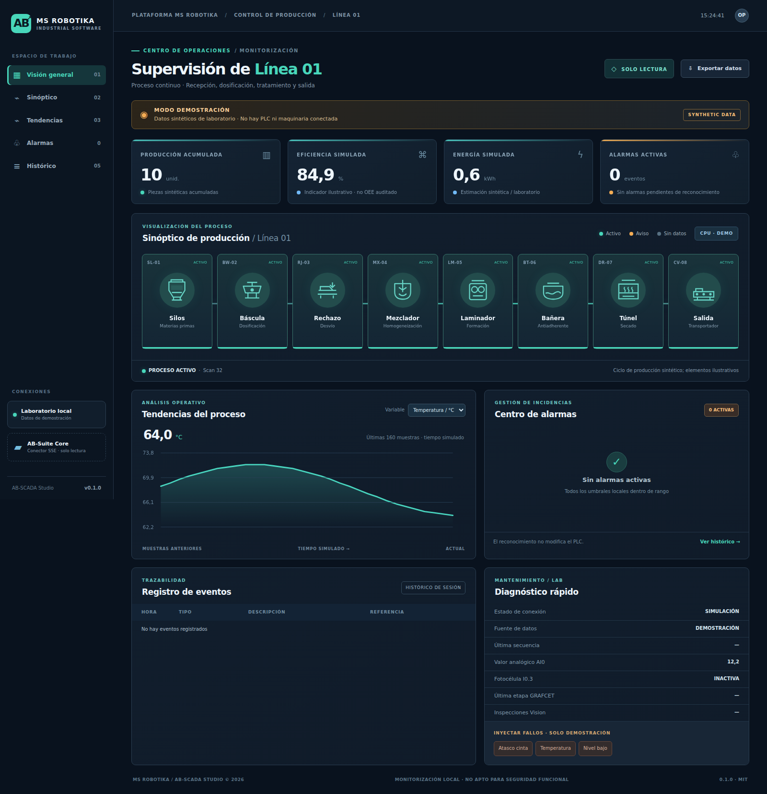
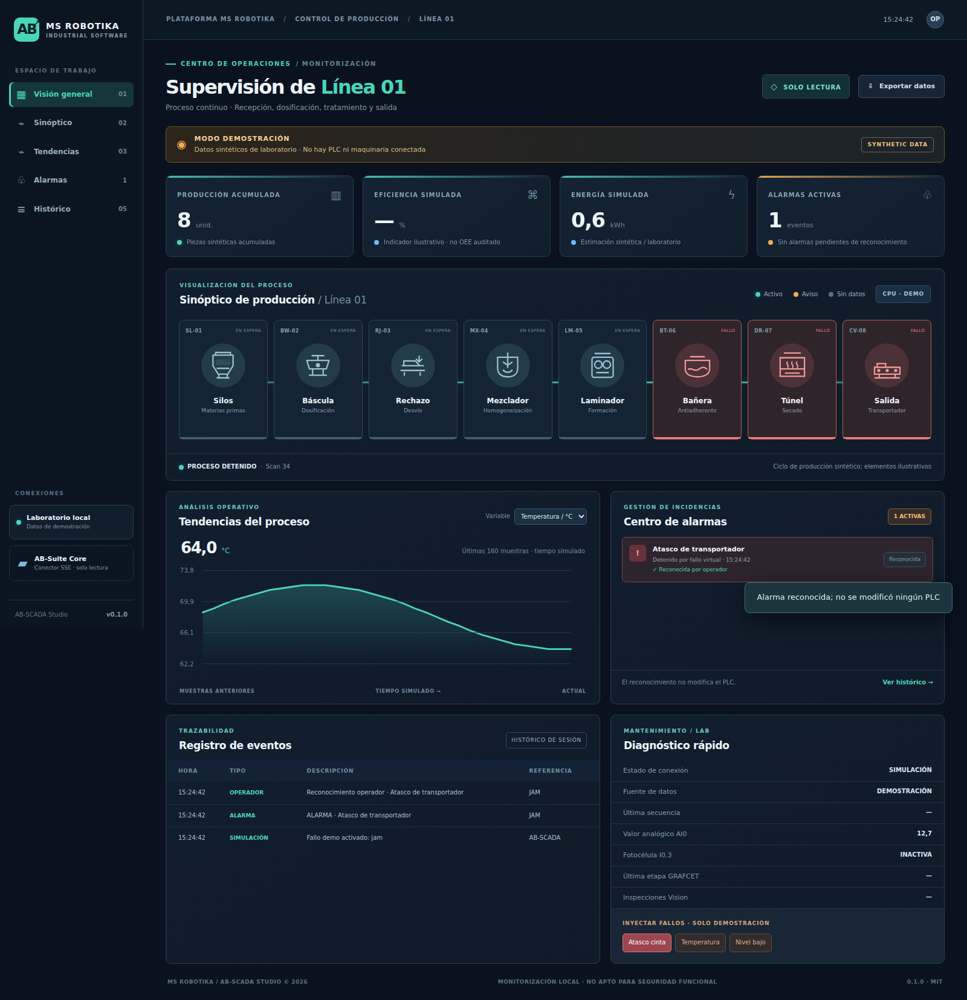
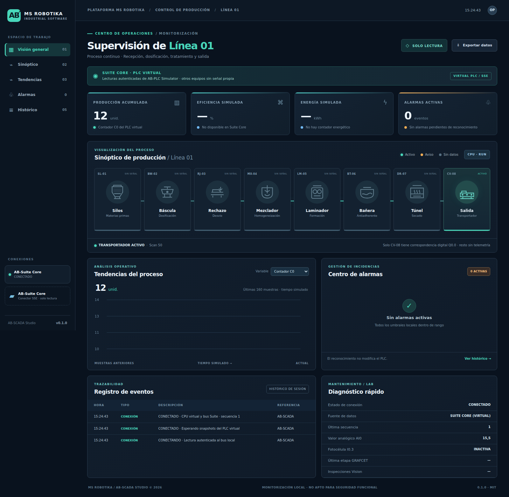

> Documento de la aplicación independiente de origen. La entrada, conexiones y capturas de la distribución integrada se describen en el [README de AB Suite](../../README.md). Las capturas históricas de este documento no representan el rediseño actual.

# AB-SCADA Studio

**MS ROBOTIKA | Supervisión industrial local de solo lectura | v0.1.0**

AB-SCADA Studio es una aplicación original, independiente y de código abierto para supervisar procesos industriales de forma virtual. **No es otro editor KOP**, no duplica el motor PLC y no escribe sobre equipos industriales.

## Capturas reales de Chromium

| Visión general | Fallos y reconocimiento |
| --- | --- |
|  |  |

Estas imágenes las genera scripts/capture.mjs al ejecutar el navegador real. La captura CORE usa un productor local de prueba; la prueba de integración con el servidor Suite Core auténtico se ejecuta por separado en CI.

## Funcionalidades

- Sinóptico original de **Línea 1**: silos, báscula, rechazo, mezclador, laminador, bañera antiadherente, túnel y salida.
- KPIs de producción, OEE y energía **exclusivamente ilustrativos** en DEMO.
- Alarmas, reconocimiento local, restauración de condición, historial de eventos y CSV.
- Tendencias SVG, dashboard responsivo y monitor de señales.
- Dos modos separados: DEMO y CORE (SSE autenticado desde AB-Suite Core).
- En CORE, el PLC virtual aporta Q0.0, I0.3, AI0, C0 y fallos. Los otros equipos aparecen SIN SEÑAL. No se inventan temperaturas, OEE o energía.
- Localhost exclusivamente. Token Suite Core conservado en servidor Node, nunca en la web.

## Arranque rápido: DEMO

Node.js 20 o superior. Ejecuta:

    git clone https://github.com/msrobotika/AB-SCADA-Studio.git
    cd AB-SCADA-Studio
    npm start

Abre **http://127.0.0.1:4180**. No necesita PLC, cámaras, broker ni software externo. Usa los botones de prueba de fallos para activar y reconocer alarmas. Son datos sintéticos.

## Integración de PLC virtual mediante AB-Suite Core

**Terminal A (AB-PLC Simulator):**

    cd AB-PLC-Simulator
    npm install
    npm run suite:core

Abre la HMI privada del PLC y pulsa RUN y MARCHA. Copia el token efímero llamado **monitor** que imprime AB-Suite Core.

**Terminal B (PowerShell, AB-SCADA Studio):**

    cd AB-SCADA-Studio
    $env:AB_SUITE_MONITOR_TOKEN = "<TOKEN_MONITOR_DEL_BUS>"
    $env:AB_SUITE_CORE_URL = "http://127.0.0.1:4175"
    npm run start:core

Abre http://127.0.0.1:4180. El sinóptico muestra SUITE CORE · PLC VIRTUAL. La salida CV-08 refleja Q0.0. **No representa sensores ni maquinaria reales de Arnedo**. El SCADA nunca emite órdenes de PLC ni escrituras Modbus.

Un cursor de bus caducado (HTTP 409) genera estado BRECHA y requiere reinicio explícito: no se omiten eventos silenciosamente.

## Pruebas y documentación

    npm test
    npm run check
    npm install
    npx playwright install chromium
    npm run screenshots

GitHub Actions prueba Node 20/22 en Ubuntu, Windows y macOS, el servidor auténtico de AB-Suite Core y Chromium real con capturas. Ver [arquitectura](docs/ARCHITECTURE.md), [tags de Línea 1](docs/LINE_1_TAGS.md), [roadmap](docs/ROADMAP.md) y [seguridad](SECURITY.md).

**Limitaciones:** No OPC UA industrial, escritura Modbus, configurador PLC, persistencia de alarmas después del reinicio, historizador durable ni OEE medido. El reconocimiento no actúa sobre máquinas. No sustituye funciones de seguridad industrial.

**Licencia MIT · Copyright © 2026 MS ROBOTIKA.**
