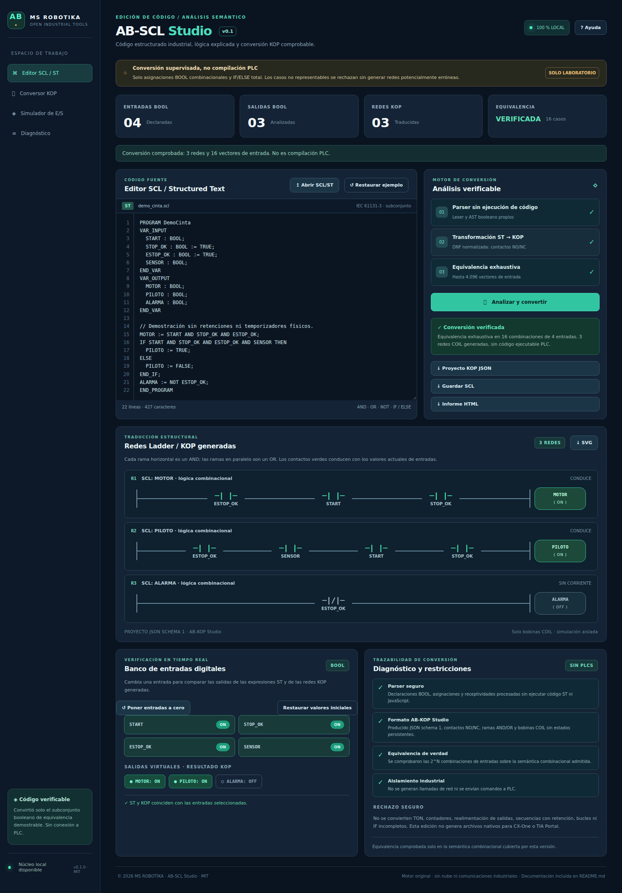
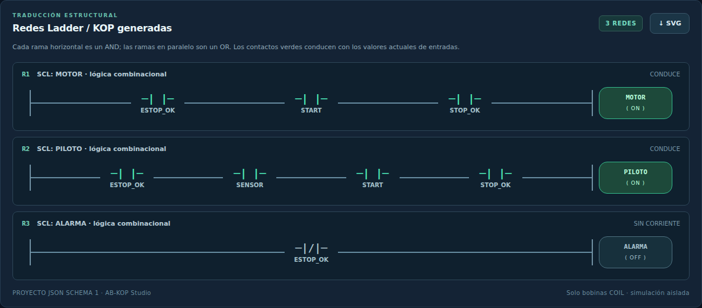
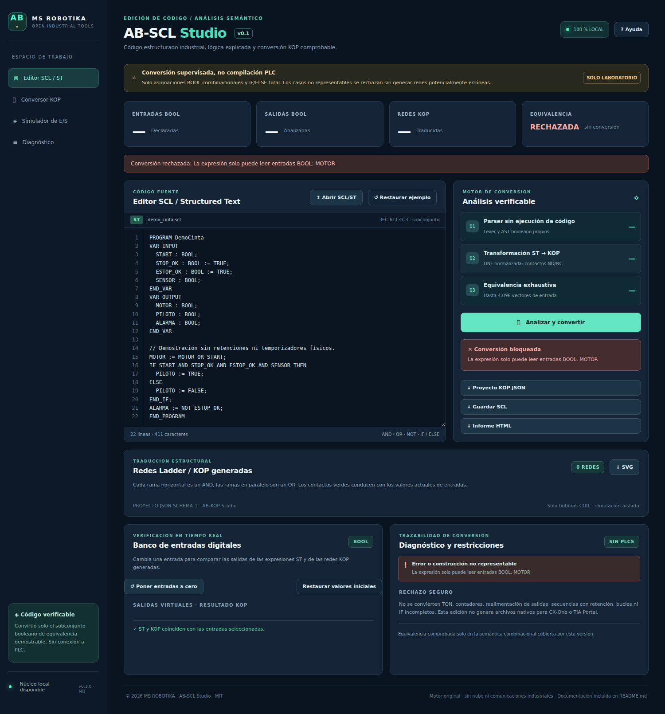
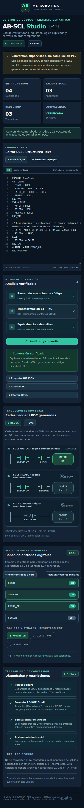

> Documento de la aplicación independiente de origen. La entrada, conexiones y capturas de la distribución integrada se describen en el [README de AB Suite](../../README.md). Las capturas históricas de este documento no representan el rediseño actual.

# AB-SCL Studio · MS ROBOTIKA

> **Ficha del proyecto · MS ROBOTIKA**  
> **Área:** Conversor ST/SCL → KOP · **Estado:** v0.1 · laboratorio / conversión booleana comprobada  
> **Evidencia:** [CI y pruebas](https://github.com/msrobotika/AB-SCL-Studio/actions) · [Capturas del programa](docs/screenshots/) · [Alcance y pendientes](docs/PROJECT_STATUS.md)  
> **Límite:** No admite lógica secuencial ST general ni compila para PLC.

**v0.1.0 · Analizador y conversor seguro ST/SCL → KOP · Español · MIT · 100 % local**

Software original que convierte **un subconjunto booleano combinacional** de Structured Text en contactos y bobinas Ladder/KOP. Rechaza las construcciones que no pueda representar fielmente. No conecta a PLC ni genera código ejecutable industrial.

## Abrir y descargar

[**AB-SCL-Studio-PORTABLE.html**](AB-SCL-Studio-PORTABLE.html) — descárgalo y ábrelo con Edge, Chrome o Firefox, sin instalar nada.

[**Descargar proyecto completo ZIP**](https://github.com/msrobotika/AB-SCL-Studio/archive/refs/heads/main.zip) · [Código fuente](src/)

## Capturas auténticas de Chromium

Las imágenes las genera el [workflow de pruebas](.github/workflows/ci.yml) al **ejecutar el HTML real** y comprobar su comportamiento; no son maquetas.

### Editor SCL/ST y verificación



### Diagrama KOP generado



### Rechazo seguro de código no representable



### Interfaz móvil



## Experiencia de usuario y puesta a cero

El banco digital incluye **Poner entradas a cero** (todas las entradas OFF) y **Restaurar valores iniciales** (los definidos en `VAR_INPUT`). Estas operaciones actualizan las salidas y la visualización **sin modificar el código fuente ni exportaciones**. El botón **Restaurar ejemplo** ofrece **Recuperar borrador** para deshacer esa sustitución en la sesión actual. Una conversión rechazada no permite exportar KOP.

## Funciones de v0.1

- Editor e importación de archivos `.scl`, `.st`, `.txt`.
- Lexer y parser propios: `VAR_INPUT`, `VAR_OUTPUT` BOOL, asignación `:=`, `AND`, `OR`, `NOT`, `TRUE`, `FALSE`, paréntesis y `IF ... THEN ... ELSE ... END_IF;` sin anidamiento.
- Transformación a contactos NO/NC, ramas serie/paralelo y bobinas COIL del **JSON schema 1 de AB-KOP Studio**.
- Comparación exhaustiva de salidas ST y KOP para hasta **12 entradas (4.096 combinaciones)**.
- Simulación de entradas digitales, exportación de proyecto KOP JSON, plano SVG, código SCL e informe HTML escapado.
- Sin dependencias externas en tiempo de ejecución ni peticiones de red.

### Ejemplo mínimo

```scl
PROGRAM Demo
VAR_INPUT
  START : BOOL;
  STOP_OK : BOOL := TRUE;
END_VAR
VAR_OUTPUT
  MOTOR : BOOL;
END_VAR
MOTOR := START AND STOP_OK;
END_PROGRAM
```

## Alcance y seguridad

**No es un compilador completo de IEC 61131-3.** La conversión requiere que cada salida sea BOOL, se asigne de forma total y única, y dependa únicamente de entradas BOOL. Se rechazan IF sin ELSE, IF anidados, referencias a salidas, retenciones, enclavamientos, variables internas, TON/TOF, contadores, bucles, CASE, comparaciones numéricas, tipos no BOOL y expresiones que superen límites. No se crea código nativo para CX-One, Siemens ni otro PLC.

La equivalencia solo demuestra el comportamiento del **subconjunto combinacional implementado**, no la semántica completa de un controlador. No utilizar estos resultados para funciones de seguridad ni accionar maquinaria sin revisión y validación independientes.

## Pruebas

```bash
node --check src/core.js
node --check src/app.js
node --test tests/*.test.js
python -m pip install 'playwright>=1.55,<2'
python -m playwright install chromium
python -m unittest discover -s tests -p 'test_browser.py' -v
```

La integración comprueba el formato y el comportamiento contra el **motor original de AB-KOP Studio v0.1** en la CI. Las capturas se regeneran con Chromium.

© 2026 **MS ROBOTIKA** · [MIT](LICENSE) · [Seguridad](SECURITY.md) · [Hoja de ruta](ROADMAP.md) · [Cambios](CHANGELOG.md) · [Contribuir](CONTRIBUTING.md). Código original desarrollado con asistencia de IA.
