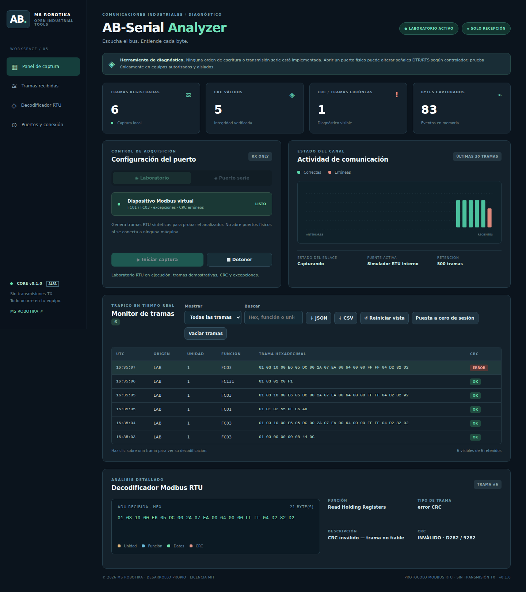
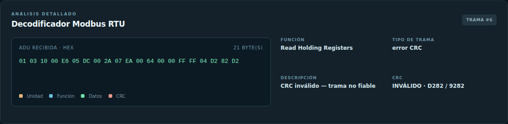
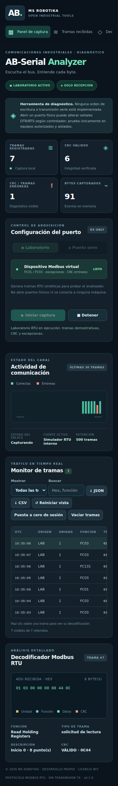

> Documento de la aplicación independiente de origen. La entrada, conexiones y capturas de la distribución integrada se describen en el [README de AB Suite](../../README.md). Las capturas históricas de este documento no representan el rediseño actual.

# AB-Serial Analyzer · MS ROBOTIKA

> **Ficha del proyecto · MS ROBOTIKA**  
> **Área:** Diagnóstico de comunicaciones serie · **Estado:** v0.1 · laboratorio y recepción opcional de hardware  
> **Evidencia:** [CI y pruebas](https://github.com/msrobotika/AB-Serial-Analyzer-v0.1-/actions) · [Capturas](docs/screenshots/) · [Estado técnico](docs/PROJECT_STATUS.md)  
> **Límite:** La captura RS-485 real y su precisión temporal necesitan pruebas con adaptadores físicos.

**v0.1.0 · MIT · Windows/Linux · español · recepción de diagnóstico**

Analizador serie y Modbus RTU con motor propio CRC16, monitor hexadecimal, tráfico de demostración, decodificación de funciones y errores, gráficos, filtros, exportación CSV y JSON y captura RX opcional mediante pySerial.

**Repositorio independiente de MS ROBOTIKA**. Este repositorio ya es público; el código y las capturas están disponibles sin conexión a la cuenta.

## Capturas reales (laboratorio Modbus RTU)

Capturas de [GitHub Actions](.github/workflows/serial-ci.yml), ejecutando el servidor local con tramas generadas por el motor Python y fotografiadas por Chromium. Si no aparecen aún, la ejecución automática no se ha completado; no son mockups.

**Decodificador RTU y registros:** 

**Interfaz móvil:**

## Controles de reinicio de la demo

**Reiniciar vista** restablece filtros, búsqueda y selección **sin borrar tramas**. **Vaciar tramas** borra solo el historial tras confirmación y no detiene una captura activa. **Puesta a cero de sesión** solicita confirmación, detiene la adquisición, borra los eventos y contadores y deja la conexión cerrada; los ajustes del puerto se conservan. Nunca se borra información sin distinguir estas operaciones.

## Descargar y ejecutar

[**Descargar proyecto en ZIP**](https://github.com/msrobotika/AB-Serial-Analyzer-v0.1-/archive/refs/heads/main.zip)

Requiere Python 3.11 o posterior. Desde la carpeta extraída, ejecuta `python -m ab_serial` (en Linux `python3 -m ab_serial`), o `AB-Serial-Analyzer.bat` en Windows / `sh AB-Serial-Analyzer.sh` en Linux. Para probarlo pulsa **Iniciar captura** en **Laboratorio**. No necesita hardware.

Para puerto físico: `python -m pip install "pyserial>=3.5,<4"`. Elige un puerto detectado por el sistema, velocidad, paridad y bits; autoriza expresamente su apertura. Ninguna API transmite datos al bus. **Aviso:** abrir un adaptador puede alterar DTR/RTS; el software RX no garantiza escucha RS-485 pasiva ni temporización de calidad industrial.

## Arquitectura y pruebas

`ab_serial/protocol.py` es un decodificador RTU sin bibliotecas Modbus; `engine.py` gestiona adquisición y simulador; `server.py` expone una API protegida solo en 127.0.0.1; `web/` es una interfaz propia sin CDN.

Ejecuta `python -m unittest discover -s tests -v` y `node --check ab_serial/web/app.js`. La captura E2E emplea Playwright/Chromium opcionales y un servidor real, sin generar valores de interfaz ficticios.

Límites: 500 eventos en memoria, lectura de FC01–04 y observación de funciones de escritura (FC05/06/15/16), CRC erróneos y excepciones, sin envío de comandos ni nube. No usar en protección, seguridad o control de máquinas. No existe certificación ni validación sobre hardware físico.

Copyright © 2026 MS ROBOTIKA · [MIT](LICENSE). Código original desarrollado con asistencia de IA. [Seguridad](SECURITY.md) · [Hoja de ruta](ROADMAP.md) · [Dependencias](DEPENDENCIES.md).
