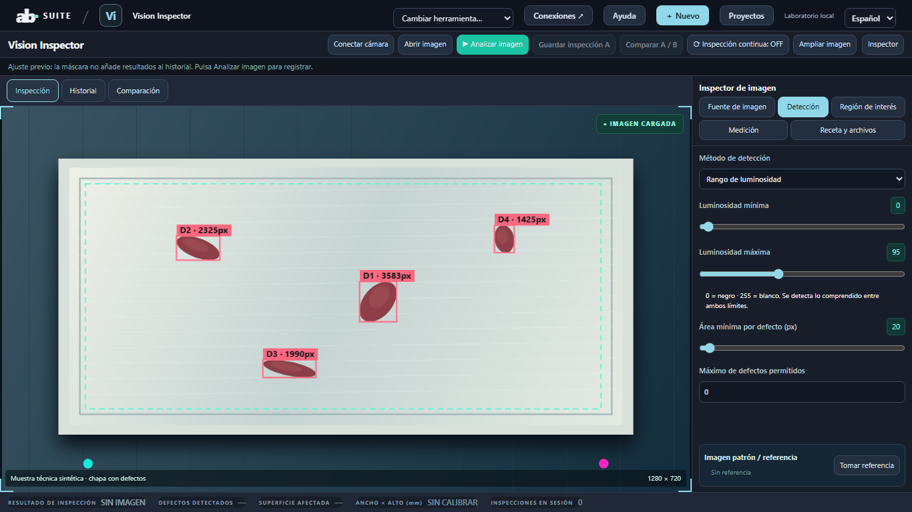

# Vision Inspector · AB Suite

Esta es la versión integrada de **AB Suite 0.6.1**, mantenida en este repositorio. [Descargar e instalar toda la suite](../../README.md#descargar-e-instalar). Se puede usar esta herramienta sin abrir las demás.

Imágenes y cámara USB/IP, dispositivo seleccionable, directo con máscara, captura congelada y análisis. Dos límites inclusivos de luminosidad, región y recetas recuperables.

**Uso:** abre el catálogo en `http://127.0.0.1:4170`, elige Vision Inspector y pulsa Nuevo para crear trabajo propio. Los ejemplos son opcionales. Nuevo conserva un punto anterior en Proyectos. No abras los HTML aislados.

**Límite real:** La previsualización no registra inspecciones. La metrología requiere calibración independiente; no es reconocimiento semántico.

[Primer uso y recuperación](../../docs/NEW_USER_WORKFLOW.md) · [Instalación ES/EN](../../docs/LOCALIZATION_AND_INSTALLATION.md) · [Validación de la suite](../../docs/VALIDATION.md) · [Capturas actuales](../../docs/SCREENSHOTS.md) · [MIT](LICENSE).

English: this tool belongs to the integrated AB Suite. Use the shared launcher and installation guide; the original standalone repository is recorded in [sources.json](../sources.json).
