# Capturas actuales · revisión 0.6.1

Capturas reales de la aplicación instalada en Windows/Chromium, con proyectos de prueba sin datos personales. La cámara de aceptación es sintética; no acredita hardware físico. Sustituyen las galerías de interfaces independientes anteriores.

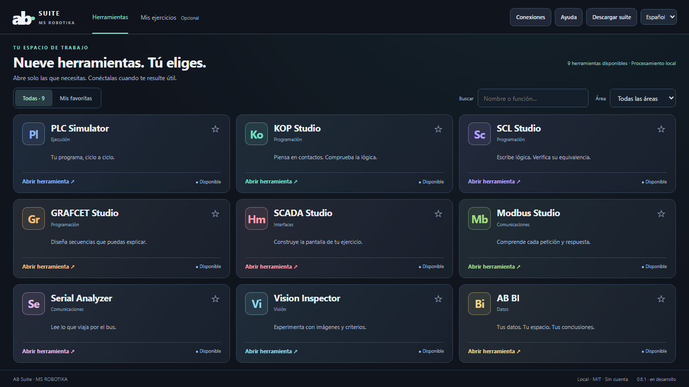

## Trabajo en KOP y Vision

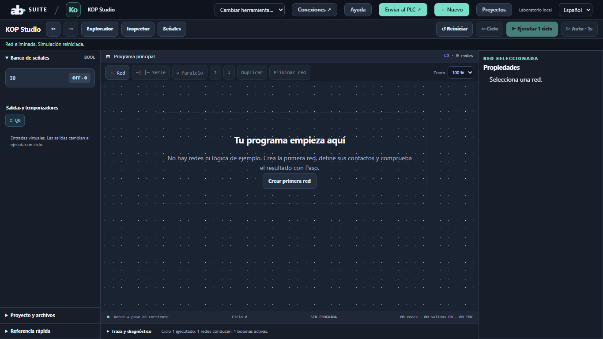

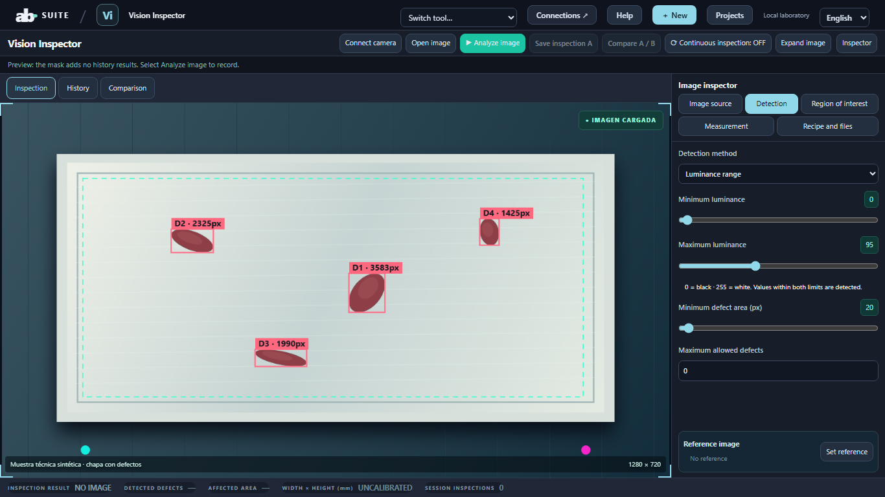

## Las nueve ventanas de trabajo

### PLC Simulator

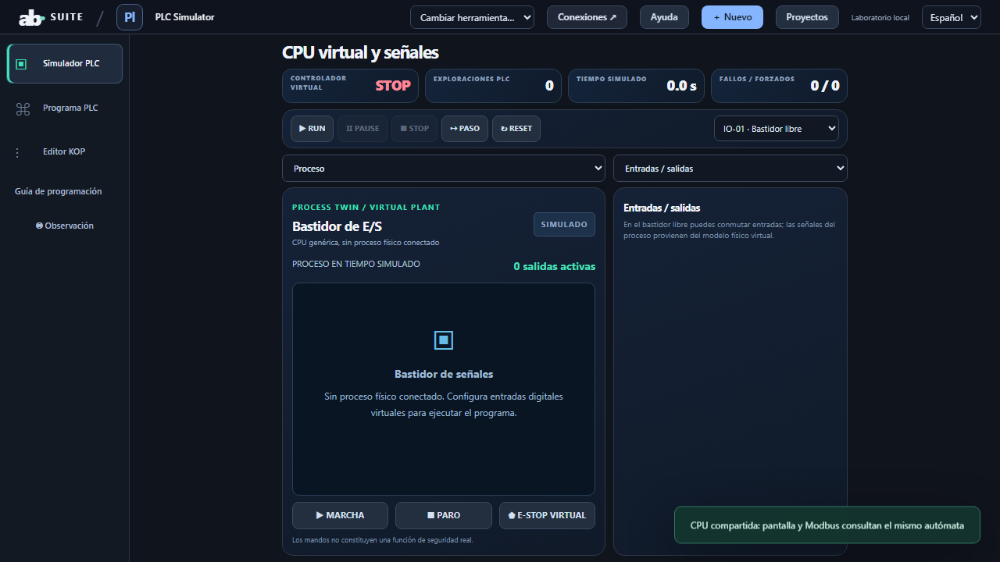

### KOP Studio

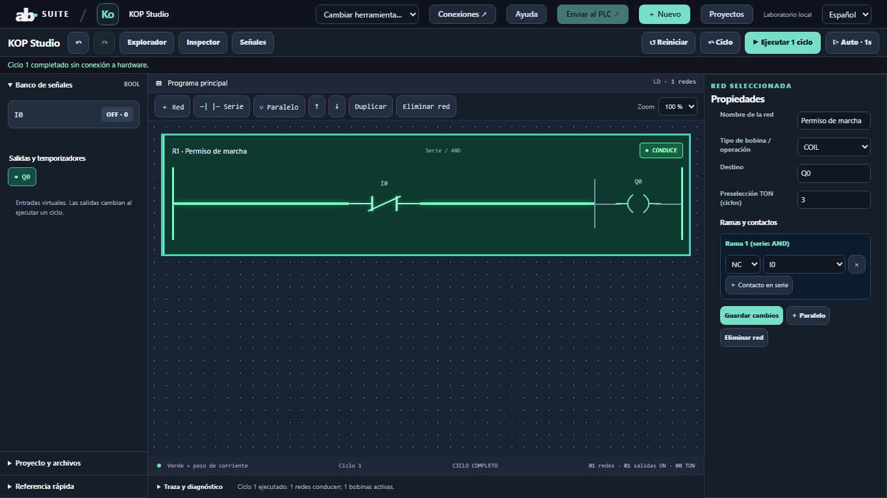

### SCL Studio

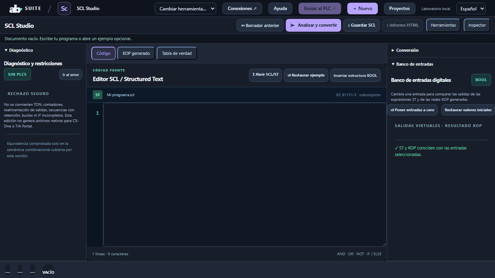

### GRAFCET Studio

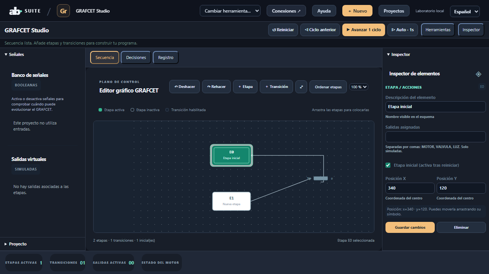

### SCADA Studio

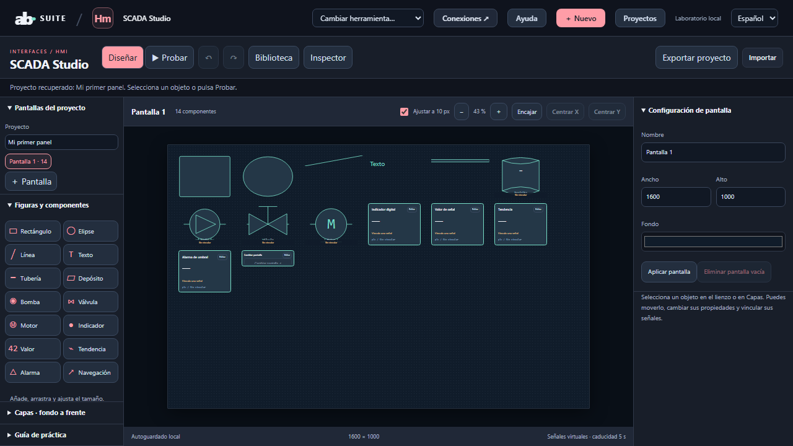

### Modbus Studio

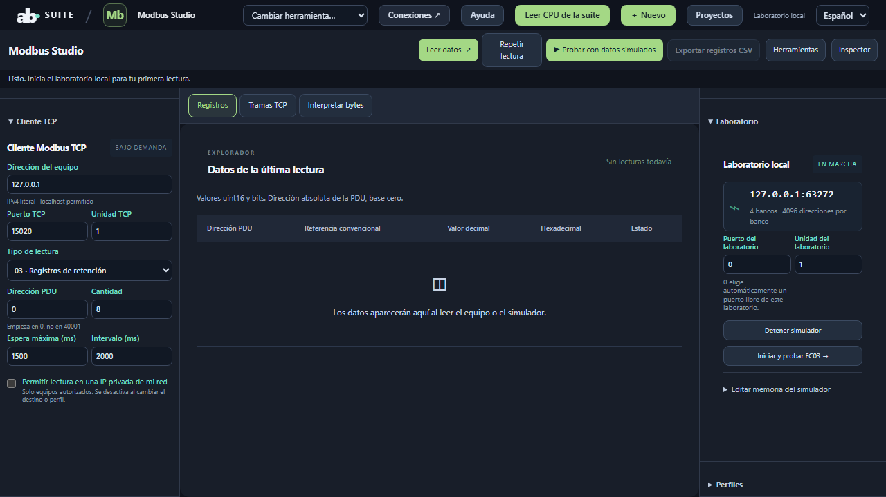

### Serial Analyzer

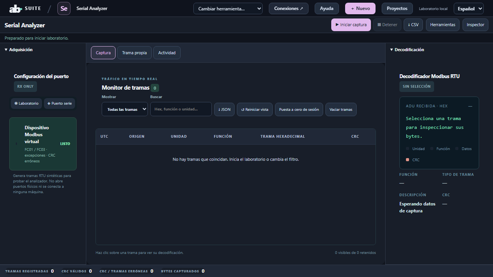

### Vision Inspector

### AB BI

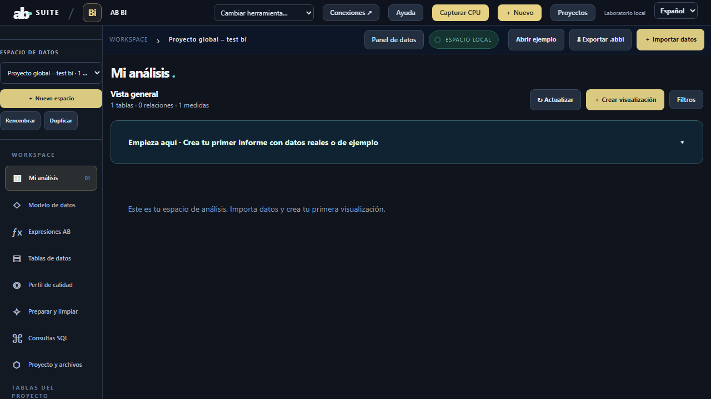
